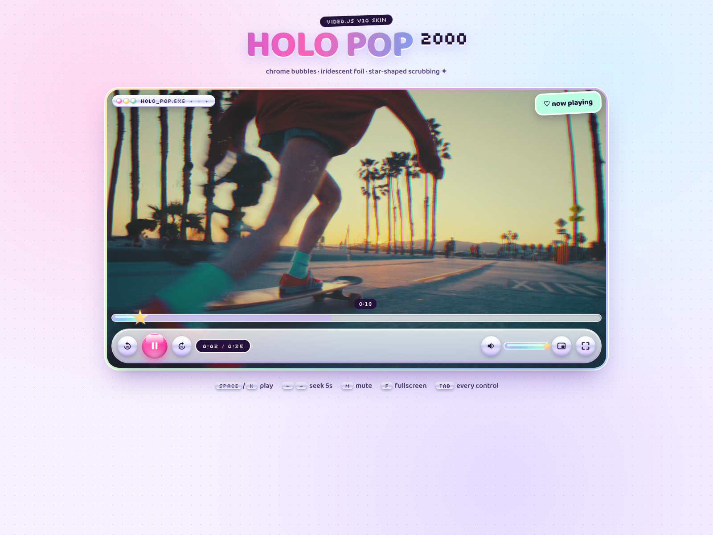

# HOLO POP 2000 ✦ a Y2K skin for Video.js v10

**Live demo:** https://yohunshadow.github.io/videojs-y2k-skin/

A Y2K / Gen Z skin for Video.js v10 (`@videojs/html` 10.5, loaded from the official jsDelivr CDN), built entirely on v10's player custom elements: `media-play-button`, `media-time-slider`, `media-volume-slider`, `media-seek-button`, `media-pip-button`, `media-fullscreen-button`, `media-hotkey`, `media-status-announcer` and `media-error-dialog`.

## Design
- **Iridescent foil frame.** A slowly rotating conic holographic gradient border, animated with an `@property` angle.
- **Bubbly chrome buttons.** Glossy pill and orb controls with a specular highlight and squishy spring hover and press motion. The play button is a hot-pink candy bubble.
- **Star-shaped scrubber.** The timeline and volume thumbs are gold-to-pink stars that spin 72° and grow while you drag. The fill is a moving holographic foil.
- **Sticker UI.** A tilted `♡ now playing` / `✿ paused, bestie` sticker flips colour with playback state. A decorative `holo_pop.exe` window bar has candy traffic lights, and the time is a pixel-font chip.
- **Sparkle burst.** ✦ ✧ ★ ♡ particles pop out of the play button when playback starts.
- Palette: lilac, baby blue, hot pink, mint and butter on frosted chrome. Fonts: Baloo 2 and Silkscreen.

## Accessibility
- Every control is a real Video.js v10 element with a built-in role and an accessible name: "Play/Pause", "Seek backward 10 seconds", "Mute", "Volume" slider, "Enter fullscreen", and so on.
- Fully keyboard operable: Tab through every control, arrow keys on the sliders, and hotkeys Space/K (play), ←/→ (seek 5 s), M (mute), F (fullscreen).
- A thick white + hot-pink double **focus ring** with a glow. The controls stay visible while anything inside them has keyboard focus.
- Icons and text use dark ink `#24123d` on pastel chrome (well above WCAG AA). The time chip is white on ink.
- `media-status-announcer` reads state changes to screen readers. Decorative layers (sticker, window bar, sparkles) are `aria-hidden`.
- `prefers-reduced-motion` turns off every animation and transition, including the sparkles. `forced-colors` mode swaps in system colours and a round thumb.
- Responsive: a container query hides secondary controls on small players.

## Files
- `index.html`: demo page and skin markup
- `holo-pop.css`: the skin
- `holo-pop.js`: optional enhancement (state attribute + sparkle burst)
- `shots/`: screenshots and a short demo recording

Sample video: Video.js / Mux public demo asset.

## License
Apache-2.0
